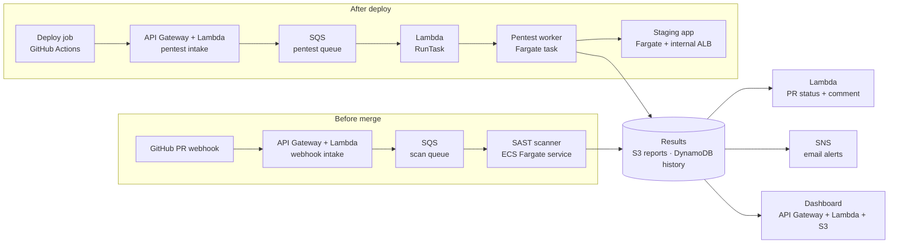

# DoubleCheck

**Catch it in the code. Catch it in the app.**

DoubleCheck is a cloud security platform on AWS that checks every change twice: it scans the code on every pull request (SAST) and blocks risky merges, then attacks the deployed staging app (API pentest) and links any runtime issues back to the PR that caused them.

> CS6620 Cloud Computing · Northeastern University
> Elenta Suzan Jacob · Rahul Gudivada

🚧 **Status:** early build. Architecture and contracts are defined; services are being implemented.

---

## The problem

Security mistakes slip through code review, and some issues (like a missing rate limit or missing security headers) are invisible in the code and only show up once the app is running. Usually nobody notices until production.

## How it works

| Checkpoint | When | Tool | What happens |
|---|---|---|---|
| **1 · Before merge** | A PR is opened or updated | SAST scanner | Code is scanned; HIGH findings fail the PR check and branch protection blocks the merge. Results are posted as a PR comment. |
| **2 · After deploy** | Merged code goes live on staging | API pentest tool | The running staging app is attacked; findings are posted as a follow-up comment on the original PR and emailed to the team. |
| **Dashboard** | Anytime | – | Trends over time, gate outcomes, and new vs. fixed issues per repo. |

Developers never leave GitHub: results appear right on their PR.

### Example PR comment

```
DoubleCheck: Blocked
SAST: 1 HIGH
  Hardcoded password in auth.js, line 14
  Fix: move it to an environment variable
[View full report]
```

---

## Architecture



**Across all services:** Secrets Manager (GitHub token, webhook secrets) · CloudWatch (logs, metrics, alarms) · ECR (Docker images)

### Network

- One VPC across two Availability Zones.
- **Private subnets:** SAST scanner, pentest worker, staging app and its internal ALB. No public IPs.
- **Public subnets:** NAT Gateway only (outbound to GitHub).
- **Staging is reachable only from the pentest worker**, enforced by security groups that reference each other (`sg-pentest-worker → sg-staging-alb → sg-staging-app`).
- S3 and DynamoDB are reached through gateway VPC endpoints.

### AWS services

| Service | Role |
|---|---|
| API Gateway (HTTP API) | Public HTTPS entry for webhooks, pentest trigger, dashboard + API |
| Lambda | Webhook verification, job intake, PR feedback, DLQ handling, timeout sweeper, dashboard |
| SQS | Scan and pentest job queues, with retries and dead-letter queues |
| ECS Fargate + ECR | Runs the SAST scanner, pentest worker and staging app as containers |
| S3 | Full scan reports and dashboard files |
| DynamoDB | Scan history, job tracking, commit-to-PR mapping |
| SNS | Email alerts for HIGH findings and failed pentests |
| EventBridge | Timeout sweeper schedule, ECS task-stopped events |
| Secrets Manager | GitHub token and webhook secrets (SSM Parameter Store as fallback) |
| CloudWatch | Logs, metrics and alarms |

> **Note:** CloudFront is blocked in AWS Academy Learner Lab, so the dashboard is served from S3 through API Gateway + Lambda over HTTPS instead.

---

## Per-repo configuration

Each protected repo adds a `.security-gate.yml`:

```yaml
version: 1
block_on: HIGH        # fail the PR check
warn_on: MEDIUM       # pass, but flag it in the comment
pentest:
  endpoints:
    - /api/users
    - /api/login
  safe_mode: false    # true = skip aggressive tests
```

No file → defaults to blocking on HIGH.

---

## Repository layout

```
doublecheck/
├── docs/              Contracts, proposal, architecture diagrams
├── shared/            normalize / fingerprint / mask (used by both workers)
├── sast-scanner/      Course SAST scanner + SQS worker + GitHub feedback
├── pentest-worker/    Course pentest tool + endpoint loop + result saving
├── lambdas/           Webhook intake, pentest intake, RunTask, results,
│                      DLQ handler, sweeper, dashboard API, dashboard site
├── dashboard/         Frontend
├── infra/             AWS setup scripts (network, storage, queues)
└── .github/workflows/ Image builds → ECR, Lambda deploys
```

The `src/` folders in `sast-scanner/` and `pentest-worker/` contain the course-provided tools ([aanchan/cs6620](https://github.com/aanchan/cs6620)); DoubleCheck extends them rather than replacing them.

The demo target app lives in a separate repo, **library-app**: a sample Node.js API with deliberately seeded vulnerabilities.

---

## Docs

- [`docs/contracts.md`](docs/contracts.md): job messages, normalized findings, S3 layout, DynamoDB tables, GitHub conventions
- [`docs/proposal.pdf`](docs/proposal.pdf): project proposal

---

## Success targets

| Metric | Target |
|---|---|
| PR opened → status + comment | < 2 min |
| Deploy → pentest results | < 10 min |
| Seeded demo vulnerabilities detected | 100% |
| Dashboard load | < 1 s |
| Hardcoded secrets in DoubleCheck itself | 0 |

---

## Team

| | Owns |
|---|---|
| **Rahul Gudivada** | Stage 1 (webhook intake, SAST scanner, PR feedback, thresholds), reliability (DLQ, sweeper), data layer and dashboard API |
| **Elenta Suzan Jacob** | Stage 2 (VPC/network, staging app, pentest trigger and worker, commit-to-PR mapping), SNS alerts, dashboard frontend |
| **Shared** | Contracts, Secrets Manager, CloudWatch, testing, demo |
